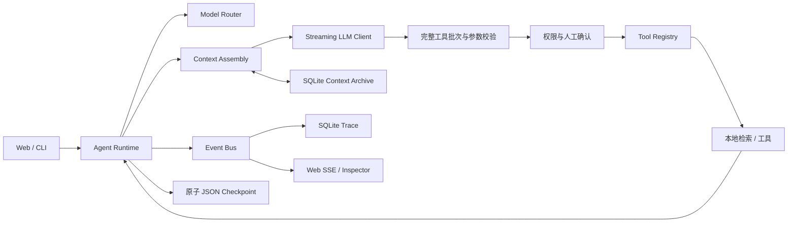

# 系统架构

## 运行链路

Web 提供研究工作台、知识库、设置与项目介绍。执行详情随回答展示；
历史查询、轨迹导出与受控分支通过 Trace API 提供。

## Python 模块职责

| 模块 | 职责 |
| --- | --- |
| `agent/core.py` | 对话、模型请求、工具调度和恢复策略接线 |
| `agent/task.py` | 状态边界、暂停/取消/恢复、执行阶段与 Checkpoint 恢复 |
| `agent/runtime.py` | 状态枚举与合法转换、Event Bus、Middleware、预算数据结构 |
| `agent/budget.py` | API 调用前预留、返回后结算、资源预警与上限 |
| `agent/context.py` | 动态工作集、卸载、按 scope 恢复和溯源事件 |
| `agent/memory.py` | 基础消息操作及固定轮数实现；ContextMemory 的基类与基准对照 |
| `agent/observability.py` | Trace ID / Span、脱敏、SQLite 存储与指标派生 |
| `agent/checkpoint.py` / `debugging.py` | 原子快照、显式恢复与受限新执行分支 |
| `agent/recovery.py` | 异常分类、参数修正与 Query 改写 |
| `llm/` | 模型连接复用、Prompt、真实流解析与最终响应聚合 |
| `tools/` | 工具 schema、注册、执行、检索/计算/总结/上下文恢复 |
| `retrievers/` | 多路检索、结果格式化、缓存与相邻片段索引 |
| `routing/` / `semantic_router/` | 当前使用的本地模型路由；不是两个可随意删除的重复模块 |
| `ingest/` | PDF 提取、清洗、切分、CLI 建库及受限 Web 上传 |
| `model_settings.py` | 本机模型配置、操作 nonce、原子私有保存与新任务配置快照 |
| `web_app.py` / `web_runtime.py` | HTTP 路由、会话注册、任务线程和 SSE 状态窗口 |

现有根入口保留，避免破坏 `python main.py`、`python web_app.py` 和已有导入路径。
未为了目录外观引入新的服务层、框架或全仓 `src/` 迁移。

## Runtime 的安全边界

- 每个 Agent 同时只运行一个任务；状态转换经过显式校验。
- 暂停在安全边界生效；取消不撤销已发生的外部副作用。
- 阻塞 I/O 的等待可以中断；客户端尽力关闭模型流，底层线程尚未退出时不开放新执行。
- Event Bus 将观察者与核心流程解耦。关键持久化订阅失败会阻止继续调度；普通观察者异常隔离。
- Middleware 可控制请求/执行；事件订阅用于观察。两者不互相冒充。
- 工具参数不是从未完成的流片段中执行；完整批次经 JSON/Schema 校验后进入既有权限与审批路径。
- 幂等键只是提供给适配器的执行契约，真正的幂等性仍依赖工具或下游服务。

## 持久化与一致性

知识库是 JSON，Web 导入复用现有切分器，通过临时文件与原子替换提交；单进程内串行导入。
它不是多进程数据库，也不是带取消/重试队列的后台文档服务。

Context 档案与 Trace 使用本地 SQLite；Checkpoint 使用原子 JSON。各存储有自己的提交边界，
不构成跨 SQLite/JSON 的全局事务。Web 会话注册表在内存中，不能将状态持久化描述为完整工作区自动恢复。

流式文本批量发布，公开事件使用脱敏累计快照与单调序号；Trace 对高频增量合并事务。
正常终止会冲刷待写事件，进程硬崩溃可能丢失尚未提交的尾部批次。
SSE 支持游标、重连和有界缓冲缺口标记；累计内容快照用于恢复显示，不重复拼接文本。

## 前端组织

- `web/app.js`：会话、消息、任务控制、上传与结果导出。
- `web/workspace.js`：导航、Inspector、知识库浏览、命令面板与设置。
- `web/lib/`：API、Markdown、SSE、run-scoped 状态投影、流式 DOM 更新。
- `web/components/`：图标、拓扑、上下文面板、实时调试指标、图表与动效。
- `web/tokens.css`：Geist 字体与 Clarity Light 语义 Design Tokens。`styles.css`、`console.css` 保留结构和组件基线，`clarity.css` 实现新 Stitch 模板的页面布局、配色和响应式适配。
- `frontend/charts.js`：官方 ECharts 的按需源码入口；`scripts/build-console.mjs` 生成可直接服务的静态产物。

当前规模使用原生 ES Modules 与 DOM。没有引入 React/TS/Vite/Zustand，也没有框架迁移所需的状态双写。
消息流在原节点上更新，避免整段对话重建引起闪烁。动效偏好保存在浏览器本地，界面固定为浅色。

## 视觉资源与来源

当前使用用户提供的 `logo.png`，Web 副本由构建脚本同步。字体为官方 Geist Sans / Mono；
图表使用 ECharts Line + Grid + Tooltip + SVGRenderer，延迟加载，不使用演示数据。

参考 [Geist 色彩](https://vercel.com/geist/colors)、[字体层级](https://vercel.com/geist/typography)、
[Langfuse 官方 Trace 界面](https://langfuse.com/images/cookbook/otel-integration-openlit/openlit-openai-trace.png)
及 [ECharts 模块导入文档](https://echarts.apache.org/handbook/en/basics/import/)。
没有声称接入 shadcn/ReUI 的 React 组件，或逐像素还原上述产品。

`design-reference/` 仅保留当前使用的 Stitch 设计参考，不作为运行时代码；当前样式和页面以 `web/` 为准。
第三方字体、图表与公式资源的 LICENSE / NOTICE 保留在各自资源目录。

## 当前限制

没有账号、权限租户、分布式任务队列或进程间建库锁；默认只监听本机。
Trace API 不等于访问控制，浏览器本地会话保存也不等于服务端用户数据隔离。
Python HTTP 服务、JSON 知识库和进程内注册表适合当前私有工作台范围，不应被描述为公共多租户部署架构。

### 当前 Stitch 模板映射

视觉参考保存在 `design-reference/stitch_research_copilot_agent_design_system/`，原始文件保持完整。

- Workspace Empty / Active → 同一研究工作台的空白与真实流式回答状态。空白页插图从模板内嵌图片提取为本地资源。
- Agent Inspector → 回答下方默认折叠的执行详情，沿用实时事件与预算指标。
- Knowledge Base Reader → 全宽文档集合，展示论文标题与页数，提供导入、筛选和删除操作。
- PDF Import → 原生 dialog 与文件选择器，调用现有上传接口，成功后刷新文档集合。
- Settings → 参考 [CC Switch 官方界面](https://github.com/farion1231/cc-switch/tree/main/assets/screenshots) 的连接列表与独立编辑视图，保留四个现有模型档位、自动路由、密钥掩码、本机保存、预算和外观设置。此处仅借鉴布局与交互，未引入 CC Switch 的代码、品牌资源或运行时依赖。
- About → 项目介绍与静态架构图，采用新模板的字体、留白和表面层级。

界面统一使用浅色主题，自动清除历史深色偏好。模板中的示例论文、运行数字和响应内容不进入产品数据。

模型密钥查看通过独立的 `POST /api/settings/models/reveal` 完成，要求本机请求、同源 Host/Origin、自定义请求头、有效一次性 nonce 及配置版本，响应禁止缓存。普通模型配置响应仍只包含掩码；前端只在用户点击眼睛按钮时获取原值，不写入浏览器持久化存储，退出编辑时遮蔽，退出设置时清空，并丢弃晚到的查看响应。
